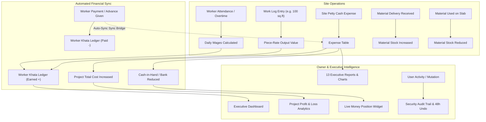
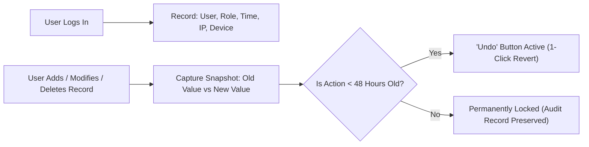

# MWCS (Modern Way Civil Solutions) — Complete Application Manual & System Guide

---

## Table of Contents
1. [Executive Summary & System Architecture](#1-executive-summary--system-architecture)
2. [User Roles & Access Permissions (RBAC)](#2-user-roles--access-permissions-rbac)
3. [Master Data Flow & Ripple Effect Architecture](#3-master-data-flow--ripple-effect-architecture)
4. [Module 1: Projects & Project Sites Management](#4-module-1-projects--project-sites-management)
5. [Module 2: Workers Directory & Khata Ledger](#5-module-2-workers-directory--khata-ledger)
6. [Module 3: Daily Attendance & Piece-Rate Work Records](#6-module-3-daily-attendance--piece-rate-work-records)
7. [Module 4: Finance, Expenses & Worker Payout Sync](#7-module-4-finance-expenses--worker-payout-sync)
8. [Module 5: Cash Book, Bank Accounts & Money Position](#8-module-5-cash-book-bank-accounts--money-position)
9. [Module 6: Partner Hisaab & Profit Settlements](#9-module-6-partner-hisaab--profit-settlements)
10. [Module 7: Material Inventory & Supplier Management](#10-module-7-material-inventory--supplier-management)
11. [Module 8: Client Quotations & Billing](#11-module-8-client-quotations--billing)
12. [Module 9: Executive Reports Suite & Visual Charts](#12-module-9-executive-reports-suite--visual-charts)
13. [Module 10: Owner Surveillance, Audit Trail & 48-Hour Undo](#13-module-10-owner-surveillance-audit-trail--48-hour-undo)
14. [Module 11: Company Settings, Branding & PWA App Installation](#14-module-11-company-settings-branding--pwa-app-installation)
15. [Quick Reference: Where to Enter What & System Impact Table](#15-quick-reference-where-to-enter-what--system-impact-table)

---

## 1. Executive Summary & System Architecture

**MWCS (Modern Way Civil Solutions)** is a full-stack, enterprise-grade Construction and Labour Project Management SaaS application engineered specifically for civil contracting firms, infrastructure builders, and interior turnkey contractors.

### Key Architectural Pillars:
- **Real-Time Cloud Synchronization**: Built on Next.js 14 App Router and high-performance Cloud PostgreSQL, providing zero-latency synchronization between remote site supervisors and head office executives.
- **Zero-Conflict Financial Engine**: Every rupee logged—whether a daily wage, cash advance, diesel purchase, or cement receipt—automatically balances across double-entry Khata ledgers, Cash-in-Hand, and Project Financials.
- **Automated Worker Payment-to-Expense Bridge**: Worker wage payouts and advances automatically record under project expenses, eliminating discrepancies between labour books and profit-and-loss balances.
- **Owner Surveillance & 48-Hour Safety Net**: Tracks who logged in, when, from which IP/device, and records old vs. new values for every data change with a 48-hour 1-click restore/undo capability.
- **Progressive Web App (PWA)**: Installable directly onto mobile home screens with offline-ready service worker caching, custom company icon, and native standalone display.

---

## 2. User Roles & Access Permissions (RBAC)

The system enforces strict Role-Based Access Control to maintain operational security:

| Role | Accessible Sections | Key Capabilities |
| :--- | :--- | :--- |
| **OWNER** | **100% of Application** | Full access to Dashboard, Financials, Partner Hisaab, Security & Audit Logs, 48-Hour Undo, Team Management, Bank Accounts, and Danger Zone Wipes. |
| **MANAGER** | Projects, Attendance, Workers, Finance, Materials, Reports | Can create and manage projects, approve expenses, track materials, and export reports. Restricted from Security Undo and Organization Settings. |
| **ACCOUNTANT** | Finance, Cash Book, Bank Accounts, Salary, Khata, Reports | Full control over Cash Book, bank reconciliations, vendor invoices, worker payouts, and expense audits. |
| **SITE_SUPERVISOR** | Attendance, Daily Expenses, Material Usage & Receipts | Optimized for mobile site use: can mark daily worker attendance, record piece-rate work outputs, log daily petty cash site expenses, and accept material deliveries. Cannot view company profit margins or partner hisaab. |
| **LABOUR / WORKER** | Worker Portal (`/worker-portal`) | Mobile number lookup to view verified attendance history, wage slips, and pending balance. No administrative access. |

---

## 3. Master Data Flow & Ripple Effect Architecture

The diagram below illustrates how an entry made in one module automatically ripples across the entire ecosystem:

---

## 4. Module 1: Projects & Project Sites Management

- **Page URL**: `/projects`, `/projects/[id]`, `/projects/financials`
- **Primary Users**: Owner, Manager

### Where & How Entries are Made:
1. **New Project**:
   - Click the **"+ New Project"** button.
   - Enter **Project Code** (e.g. `PRJ-0101`), **Project Name**, **Project Type** (Commercial, Residential, Industrial, Infrastructure), **Status** (`RUNNING`, `COMING_SOON`, `COMPLETED`, `ON_HOLD`).
   - Fill in **Client Details**: Client Name, Mobile, Site Location.
   - Set **Budget Baselines**: Total Project Value (Contract Value), Estimated Labour Cost, Estimated Material Cost, Estimated Other Cost.
   - Set **Target Metrics**: Target Quantity & Unit (e.g., `25,000 sq.ft`).
2. **Project Sites / Sub-Locations**:
   - Inside any project, open the **Sites** tab and click **"+ Add Site"** (e.g. `Tower A`, `Floor 2`, `Basement Parking`).
   - Assign a designated Site Supervisor name and mobile number.

### System Ripple Effects & Visual Impact:
- **Dropdown Population**: The project and its sub-sites immediately become available in Attendance, Expense Logging, Material Receipts, Cash Transfers, and Quotations.
- **Budget vs. Actual Variance**: The system automatically tracks actual expenses and labour wages against the estimated budget, displaying a visual progress bar and cost-per-unit metric (e.g., ₹142 / sq.ft).
- **Executive Portfolio Card**: Live summary updates on the Dashboard showing Total Portfolio Value, Active Running Projects, and Completion Rates.

---

## 5. Module 2: Workers Directory & Khata Ledger

- **Page URL**: `/workers`, `/workers/[id]`, `/worker-portal`
- **Primary Users**: Owner, Manager, Site Supervisor, Workers

### Where & How Entries are Made:
1. **Adding a Worker**:
   - Go to **Workers** -> click **"+ Add Worker"**.
   - Fill in: Full Name, Mobile Number, Father's Name, Trade/Category (Mason, Helper, Carpenter, Plumber, Electrician, Painter, Flooring, Steel Worker).
   - Define **Wage Structure**: Daily Wage Rate (e.g., ₹800) and Wage Unit (`PER_DAY` or `PER_UNIT`).
   - Set **Opening Balance** (if an existing worker has pending old dues or advance).
2. **Worker Profile & Khata Ledger**:
   - Clicking on any worker opens their complete chronological passbook:
     - All daily attendance marks and overtime earnings.
     - All piece-rate work outputs logged.
     - All advances and cash settlements paid.
     - Real-time **Net Balance (Payable / Receivable)**.

### System Ripple Effects & Visual Impact:
- **Attendance Sheet**: Worker is instantly listed under their respective trade in the daily attendance register.
- **Salary Register**: Automatically computes monthly gross salary, advance deductions, and net payable wages.
- **Worker Self-Service Portal (`/worker-portal`)**: The worker can enter their 10-digit mobile number from their own smartphone to see verified days worked, advances received, and unpaid balance, eliminating end-of-month wage disputes.

---

## 6. Module 3: Daily Attendance & Piece-Rate Work Records

- **Page URL**: `/attendance`
- **Primary Users**: Site Supervisor, Owner, Manager

### Where & How Entries are Made:
1. **Date & Project Selection**:
   - Pick the target date using the calendar input. Clicking the date automatically triggers the calendar popup via `showPicker()`.
   - Select the target **Project** and **Site**.
2. **Marking Attendance**:
   - Each worker card displays status buttons:
     - **Present (P)**: Credits 1 full daily wage.
     - **Half Day (HD)**: Credits 0.5 daily wage.
     - **Absent (A)**: Zero wage.
     - **Overtime (OT Hours)**: Enter overtime hours (e.g., 2.5 hrs). Wage is calculated as `(Daily Wage / 8) * Overtime Hours`.
   - **Quick Actions**: Use **"Mark All Present"** for 1-click batch attendance.
3. **Logging Piece-Rate Work Output (Work Record Button)**:
   - For contract/piece-rate work, click the **Hammer icon** on the worker's row.
   - Enter **Task Name** (e.g., *Waterproofing, Plaster, Tile Fixing*).
   - Enter **Quantity** and select **Unit** (`sq.ft`, `sq.m`, `rft`, `meter`, `bags`, `nos`, `hours`, `trips`).
   - Enter **Rate per Unit** (e.g., ₹15 / sq.ft).
   - **Visual Output**: The table button cleanly displays **only the work quantity and unit** (e.g. `100 sq.ft`), without cluttering the UI with currency amounts or log counts.

### System Ripple Effects & Visual Impact:
- **Instant Wage Accrual**: The worker's Khata increases immediately by the day's earnings.
- **Project Labour Cost**: The project's actual labour expenditure reflects the new wage sum in real time.
- **Reports & Charts**: Feeds directly into the Daily Attendance Report, Labour Analytics Donut Chart, and Productivity Trends.

---

## 7. Module 4: Finance, Expenses & Worker Payout Sync

- **Page URL**: `/finance/expenses`, `/finance/payments`, `/salary`
- **Primary Users**: Owner, Accountant, Site Supervisor

### Where & How Entries are Made:
1. **Site Daily Expenses**:
   - Click **"+ Add Expense"**.
   - Choose **Category**: *Chay-Nasta, Lunch, Dinner, Labour Food, Petrol/Fuel, Equipment Rental, Travel, Material, Maintenance, Site Labour, Other*.
   - Enter **Amount**, **Date**, **Payment Method** (*Cash, UPI, Bank Transfer*), **Paid By** (Partner, Supervisor, or Self), and select the **Project**.
   - Optional: Attach bill photo or receipt voucher.
2. **Worker Payouts & Advances (`/finance/payments`)**:
   - Click **"+ Make Payment"**.
   - Select Worker, Project, Transaction Type (*ADVANCE* or *PAYMENT / SETTLEMENT*), Amount, and Payment Method (*Cash, UPI, Bank*).

### System Ripple Effects & Automated Bridging:
- **Automated Labour Expense Bridging**: Whenever a worker advance or payment is saved in the payments table, the system automatically creates a corresponding `'LABOUR'` category record in the `Expense` table. This guarantees that Dashboard expense totals and Project Cost balances always reflect actual cash outflows paid to workers.
- **Khata Settlement**: Deducts the paid amount from the worker's pending wage ledger.
- **Cash Book & Bank Outflow**: Automatically reduces Cash-in-Hand or Bank Balance depending on whether Cash or UPI/Bank was selected.

---

## 8. Module 5: Cash Book, Bank Accounts & Money Position

- **Page URL**: `/cash-book`, `/finance/bank-accounts`, `/finance/transfers`
- **Primary Users**: Owner, Accountant

### Where & How Entries are Made:
1. **Client Receipts (Money-In)**:
   - Click **"+ Receive Payment"**.
   - Enter Project, Client Name, Amount Received, Payment Channel (*Bank, Cash, Cheque, RTGS*), and Received By (Partner name).
2. **Internal Fund Transfers (`/finance/transfers`)**:
   - Transfer funds between partners, from Bank to Site Cash, or from Office to Supervisor.
   - Choose Reason: *Site Daily Expenses & Petty Cash, Worker Advance, Salary Payout, Partner Drawing, Internal Settlement*.
3. **Company Bank Accounts (`/finance/bank-accounts`)**:
   - Add company current accounts, overdraft limits, or business cards.
   - Enter Bank Name, Account Number (Last 4 Digits), and Opening Balance.
4. **Daily Day-End Closing (`/api/wallet/closing`)**:
   - Physical cash count verified against system calculated balance at 08:00 PM every evening.

### System Ripple Effects & Visual Impact:
- **Live Money Position Widget**: The top metric card across the dashboard shows:
  - `Cash in Hand`: Physical cash currently held across all supervisors and partners.
  - `Bank Balance`: Cleared funds across all registered bank accounts.
  - `Total Net Liquidity`: Combined real-time cash position.
- **Discrepancy Elimination**: Detects if site expenses exceed cash distributed to a supervisor.

---

## 9. Module 6: Partner Hisaab & Profit Settlements

- **Page URL**: `/hisaab`, `/hisaab/partners`
- **Primary Users**: Owner, Partners

### Where & How Entries are Made:
- Partners do not need a separate complex accounting book. The system automatically tracks every partner's cash inflows and outflows based on their daily transactions:
  - **Cash In**: Client project payments received by that partner.
  - **Cash Out**: Site expenses, vendor bills, and labour wages paid from that partner's pocket or account.
  - **Drawings**: Personal profit withdrawals taken by that partner.

### System Ripple Effects & Visual Impact:
- **Who Owes Whom (Settlement Matrix)**:
  - Automatically calculates net position: e.g., *"Partner A collected ₹2,00,000 from client and spent ₹50,000 on site -> Partner A holds ₹1,50,000 company cash to settle."*
  - Dedicated **Single-Day Filter** and **Date Range Filter** allow partners to sit down at the end of the week or month and settle balances in under 60 seconds.

---

## 10. Module 7: Material Inventory & Supplier Management

- **Page URL**: `/materials`, `/materials/received`, `/materials/used`, `/materials/transfers`, `/materials/suppliers`
- **Primary Users**: Site Supervisor, Manager, Accountant

### Where & How Entries are Made:
1. **Supplier Directory**: Register vendors (Ambuja Cement, Tata Tiscon, Local Brick Kiln) with contact numbers and GST.
2. **Material Master**: Create stock items (e.g. *OPC 53 Cement, 12mm TMT Steel, River Sand, 20mm Aggregate, 2x2 Vitrified Tiles*), defining the Unit and Minimum Safe Stock Level.
3. **Material Receipt (Challan / Invoice)**:
   - When a truck arrives at the site, the supervisor enters: Material, Quantity Received (e.g. 200 bags), Purchase Rate (₹350/bag), Total Cost, Supplier, Project, and Invoice/Challan Number.
4. **Material Usage**:
   - When materials are consumed, log: Material, Quantity Used (e.g. 150 bags), Project Site (Tower A, 3rd Floor Slab), and Task Purpose.
5. **Material Site-to-Site Transfer**:
   - When moving surplus material from Noida Site to Gurgaon Site, log a Transfer to keep site-wise asset valuations accurate.

### System Ripple Effects & Visual Impact:
- **Automated Stock Equation**:
  $$\text{Current Stock} = \text{Opening Stock} + \text{Total Received} - \text{Total Consumed} - \text{Transferred Out}$$
- **Low Stock Alerts**: If cement drops below 50 bags, the system flashes a yellow warning on the Dashboard and sends a notification to prevent site work stoppages.
- **Financial Cost Linking**: Material purchase cost flows directly into the project's actual material expenditure.

---

## 11. Module 8: Client Quotations & Billing

- **Page URL**: `/quotations`, `/quotations/[id]`
- **Primary Users**: Owner, Manager

### Where & How Entries are Made:
1. Click **"+ Create Quotation"**.
2. Enter Client Name, Mobile, Site Location, and Quote Validity Date.
3. Add Line Items:
   - Item Name & Description (e.g. *Epoxy Flooring 3mm Self-Leveling*).
   - Quantity, Unit (`sq.ft`, `rft`, etc.), Rate (₹ / Unit).
4. System automatically computes Subtotal, GST (18% or custom), and Total Quotation Value.
5. Add Payment Terms & Conditions.

### System Ripple Effects & Visual Impact:
- **Client PDF Generation**: Produces a professional, print-ready formal estimate formatted with your company logo, GST details, authorized signature box, and bank account details.
- **1-Click Project Conversion**: Once the client approves the estimate, it can be converted directly into an active project budget.

---

## 12. Module 9: Executive Reports Suite & Visual Charts

- **Page URL**: `/reports/*` (13 Specialized Sub-Reports)
- **Primary Users**: Owner, Accountant, Manager

### Available Report Types:
1. **Labour Report**: Worker-wise days worked, overtime hours, piece-rate output, gross wages, and balance dues.
2. **Attendance Report**: Daily site presence percentage, trade breakdown, and absentees.
3. **Daily Expense Report**: Itemized breakdown of all cash and bank outflows for any specific date.
4. **Weekly & Monthly Expense Reports**: Trend analysis of site burn rate.
5. **Material Report**: Total material purchased, consumed, and remaining on-site valuation.
6. **Project Cost Report**: Comprehensive breakdown of Labour vs. Material vs. Other overheads per project.
7. **Profit & Loss Report**: Total Client Billing / Receipts minus Total Project Expenses.
8. **Khata Ledger Report**: Comprehensive vendor and worker balance summary.
9. **Salary Report**: Formal payroll sheets for monthly wage payouts.
10. **Productivity Report**: Output metrics per square foot / meter per trade.

### Visual Interactive Charts:
- **Round (Donut) Chart**: Serves as the primary executive visualization, displaying proportional cost distribution across categories with distinct color coding.
- **Pillar (Bar) Chart**: Serves as the secondary comparison visualization, displaying period-over-period or project-vs-project comparisons.
- **Date Filtering**: Full support for native calendar popups (`showPicker()`), 1-day snapshots, and custom date ranges.
- **Export Options**: 1-click **Export to Excel (CSV)** and **Print / Save as PDF**.

---

## 13. Module 10: Owner Surveillance, Audit Trail & 48-Hour Undo

- **Page URL**: `/security`
- **Primary Users**: Owner (Restricted to Owner role only)

### Key Security & Surveillance Features:

1. **Live Login Surveillance**:
   - Logs every successful and failed login attempt:
     - User Name & Email.
     - Role & Portal accessed (*Owner, Supervisor, Accountant, Worker*).
     - Exact timestamp (date & time in IST).
     - IP Address and Browser/Device Agent.
2. **Live Data Audit Trail**:
   - Monitors all changes made across Attendance, Expenses, Payments, Workers, Projects, and Materials.
   - Side-by-side **Old Value** vs. **New Value** diff view.
3. **48-Hour Undo & Rollback Engine**:
   - If an employee accidentally modifies or deletes an expense, attendance entry, or payment, the Owner sees a live countdown timer (e.g. `42h 15m remaining`).
   - Clicking **"Undo"** immediately restores the original state and reverses any financial side-effects.
   - After 48 hours, the ability to undo automatically expires to preserve accounting finality.
   - A **"Purge Expired"** button allows permanently cleaning deleted tombstones after the 48-hour window.

---

## 14. Module 11: Company Settings, Branding & PWA App Installation

- **Page URL**: `/settings`, `/users`
- **Primary Users**: Owner

### Key Administrative Controls:
1. **Company Profile & Branding**:
   - Company Name: `Modern Way Civil Solutions Pvt Ltd`
   - Owner Name, Mobile, Email, GST Number, Office Address.
   - **Official Logo Upload**: Upload high-resolution company branding logo. The logo automatically synchronizes across the login screen, sidebar, print reports, quotations, and PWA mobile icons.
2. **Team & User Accounts (`/users`)**:
   - Add new Site Supervisors, Accountants, or Partners.
   - Set login email, mobile, and password.
   - Deactivate or delete test/temporary accounts.
3. **Danger Zone (Reset & Wipe Demo Data)**:
   - When handing over to a new client or starting a fresh financial year, the Owner can click **"Wipe Demo Data & Start Fresh"**.
   - This purges 100% of test projects, workers, attendance, expenses, payments, materials, bank accounts, and audit logs while preserving company settings and login accounts.
4. **Mobile App Installation (PWA)**:
   - **App Name**: `MWCS`
   - **Full Name**: `MWCS - Modern Way Civil Solutions`
   - Users on Android Chrome or iOS Safari can click **"Install MWCS App"** in the topbar or sidebar, or use browser menu **"Add to Home Screen"** to install the app directly on their mobile home screen with the official company icon.

---

## 15. Quick Reference: Where to Enter What & System Impact Table

| What You Want to Do | Where to Go in App | Data to Enter | What Gets Updated Automatically |
| :--- | :--- | :--- | :--- |
| **Start a New Site / Work Order** | Projects -> `+ New Project` | Code, Name, Client, Budget, Units | Creates budget baseline; appears in all dropdowns; updates Dashboard portfolio. |
| **Register a New Mason/Labour** | Workers -> `+ Add Worker` | Name, Mobile, Trade, Daily Wage, Unit | Appears in attendance sheet; creates dedicated Khata; enables worker self-portal lookup. |
| **Mark Daily Haajiri / Overtime** | Attendance | Select Date, Project, Click P/HD/A/OT | Calculates day's wage; adds to Worker Khata; increases Project Labour Cost; updates Attendance Report. |
| **Log Measured Work (sq.ft / meter)** | Attendance -> Click Hammer icon on worker row | Task Name, Qty, Unit, Rate | Updates work record button to show clean output (e.g. `100 sq.ft`); credits earned value to Khata. |
| **Record Daily Site Expense / Petrol** | Expenses -> `+ Add Expense` | Category, Amount, Project, Paid By, Mode | Deducts from Cash-in-Hand; increases Project Cost; updates Daily Expense Report and Round Chart. |
| **Give Advance / Weekly Payout to Worker**| Payments -> `+ Make Payment` | Worker, Project, Amount, Cash/Bank | **Automatically creates 'LABOUR' Expense**; deducts from Worker Khata; reduces Cash-in-Hand/Bank. |
| **Receive Payment from Client** | Cash Book -> `+ Receive Payment` | Project, Client Name, Amount, Channel | Increases Cash-in-Hand or Bank Balance; updates Project Client Receipts and Outstanding Due. |
| **Internal Cash Transfer to Supervisor** | Transfers -> `+ New Transfer` | From (Office/Bank), To (Supervisor), Amount | Reallocates Cash-in-Hand; tracks supervisor's petty cash balance; logs transfer reason. |
| **Receive Cement / Steel Truck on Site** | Materials -> `+ Material Receipt` | Material, Qty, Rate, Supplier, Project | Increases Material Stock on Site; creates supplier payable; updates Project Material Cost. |
| **Log Material Consumption on Slab** | Materials -> `+ Material Usage` | Material, Qty Used, Site/Task Purpose | Decreases In-Stock Inventory; calculates consumption rate against estimated bill of quantities. |
| **Reconcile Partner Cash & Drawings** | Partner Hisaab (`/hisaab`) | Select Partner or Single-Day Filter | Computes who holds company cash and who needs reimbursement; balances profit distributions. |
| **Inspect Who Changed What or Undo Mistake** | Security (`/security`) | Check Audit Log or Login History | Displays who made the change with Old vs New values; provides 1-Click Undo within 48 hours. |
| **Install App on Smartphone** | Topbar / Sidebar -> Click `Install MWCS App` | Click "Install" in prompt | Installs standalone native-like app named `MWCS` on mobile home screen with official logo. |
